<!-- ================================================== -->
<!--              SHAMBHAVI'S GITHUB README             -->
<!-- ================================================== -->

  

  

---

## 👩🏻‍💻 About Me

Hello! I'm **Shambhavi Chouhan**, an MCA student at **Devi Ahilya Vishwavidyalaya (DAVV), Indore**.

I'm passionate about technology, programming and exploring the fascinating world of cybersecurity.

I enjoy understanding how things work, solving problems through code and continuously challenging myself to learn something new.

- 🎓 Pursuing MCA at DAVV, Indore.
- 🔐 Interested in Cybersecurity and Ethical Hacking.
- 💻 Exploring programming and software development.
- 🌱 Currently strengthening my C programming and problem-solving skills.
- 🚀 Interested in building practical projects and learning new technologies.
- 🤝 Open to internships, collaborations and learning opportunities.

---

## 🛡️ Technical Interests

| Area | Interests |
|:---:|:---|
| 🔐 Cybersecurity | Security Fundamentals, Ethical Hacking Concepts |
| 💻 Programming | C Programming, Logic Building |
| 🧠 Problem Solving | Algorithms, Computational Thinking |
| 🌐 Technology | Software Development, Emerging Technologies |

---

## ⚙️ Tech Stack

### Programming Languages

  

### Tools & Platforms

  

### Currently Exploring
- Cybersecurity fundamentals
- Ethical hacking concepts
- Programming and data structures
- Software development

---

## 🚀 Projects & Development

I believe the best way to learn technology is by building with it.

I'm working towards developing projects that strengthen my programming skills and help me understand real-world applications of technology.

📌 Explore my repositories:

**[View All My Projects →](https://github.com/Shambhavi-16?tab=repositories)**

---

## 📊 GitHub Analytics

  

  

---

## 🐍 My Contribution Journey

  <i>Every contribution is a step towards something bigger.</i>

  </picture>   <!-- CONTRIBUTION SNAKE -->

<h2 align="center">🐍 MY CONTRIBUTION JOURNEY</h2>

  <i>Every contribution is a step towards something bigger.</i>

  <picture>
    <source
      media="(prefers-color-scheme: dark)"
      srcset="https://raw.githubusercontent.com/Shambhavi-16/Shambhavi-16/output/github-contribution-grid-snake-dark.svg"
    />
    <source
      media="(prefers-color-scheme: light)"
      srcset="https://raw.githubusercontent.com/Shambhavi-16/Shambhavi-16/output/github-contribution-grid-snake.svg"
    />
    

  <b>BUILD. LEARN. CONTRIBUTE. REPEAT.</b>

<!-- END CONTRIBUTION SNAKE -->

    

  <picture>
    <source media="(prefers-color-scheme: dark)" srcset="https://raw.githubusercontent.com/Shambhavi-16/Shambhavi-16/output/github-contribution-grid-snake-dark.svg" />
    <source media="(prefers-color-scheme: light)" srcset="https://raw.githubusercontent.com/Shambhavi-16/Shambhavi-16/output/github-contribution-grid-snake.svg" />
    
  </picture>

---

## 🎨 Beyond Technology

There's more to me than just code!

- 🎤 **Public Speaking:** Love delivering speeches and expressing ideas.
- 👗 **Fashion Designing:** Interested in creativity, styling and design.
- 🎨 **Drawing:** Enjoy artistic expression and visual creativity.
- 🌍 **Social Networking:** A social butterfly who enjoys meeting people and building connections.

I believe creativity and technical thinking make a powerful combination.

---

## 🌐 Let's Connect

  

  <!-- Replace YOUR_LINKEDIN_USERNAME with your LinkedIn username -->
  

---

  <h3>✨ THINK DIFFERENTLY. BUILD FEARLESSLY. SECURE THE FUTURE. ✨</h3>

  

<!-- END OF README -->
